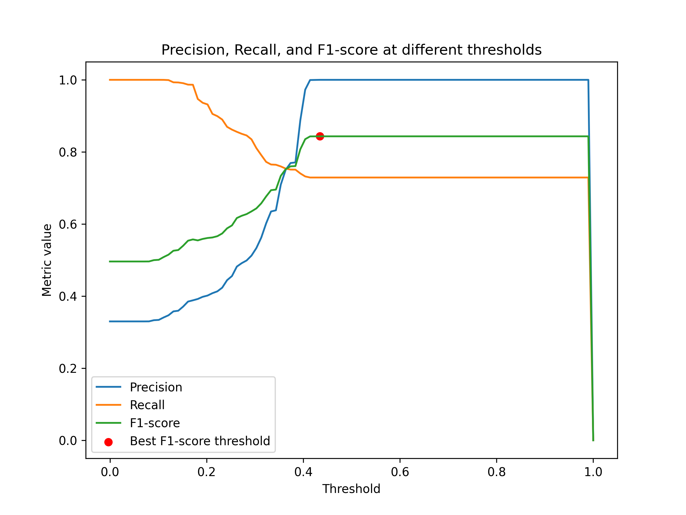
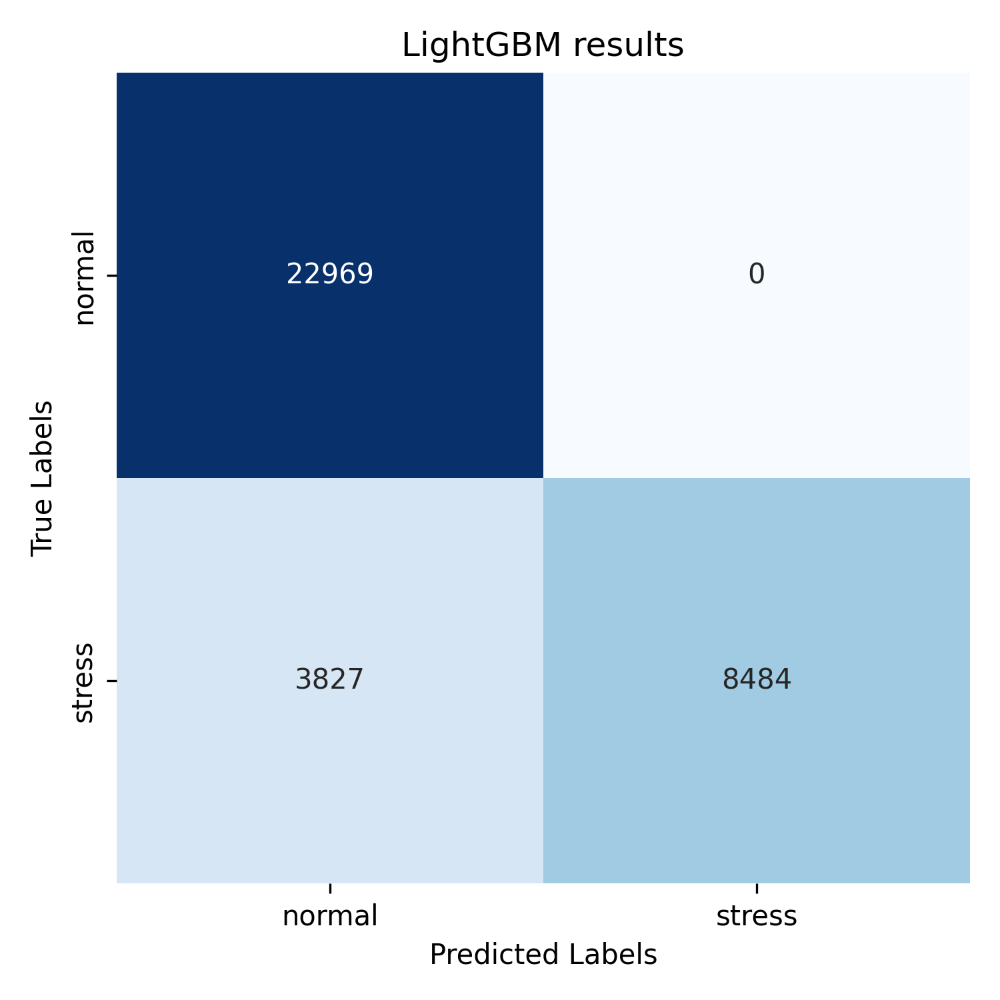
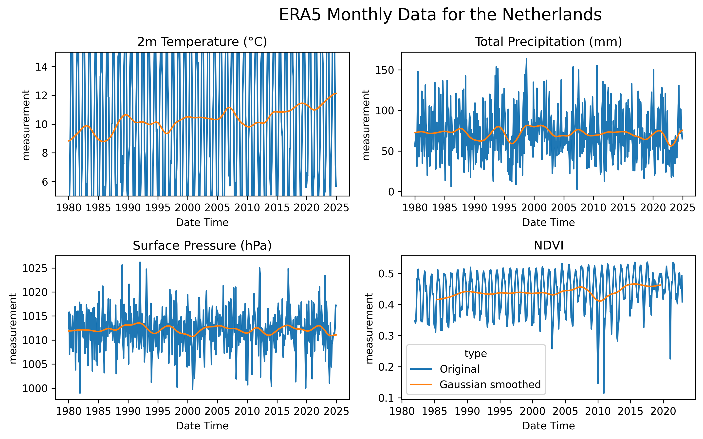

# Drought Stress Prediction

Train a LightGBM classifier to forecast vegetation stress from monthly NDVI and
ERA5 climate variables. The supported workflow is an internal, reproducible CLI
application managed with `uv`.

## Setup

Install `uv`, then create the locked Python 3.11 environment:

```powershell
uv sync --locked --group dev
uv run stress-prediction --help
```

`pyproject.toml` defines compatible dependency ranges. `uv.lock` is committed
and is the exact environment used by development and CI.

Optional dependencies are available for the geospatial pipeline, the
experimental neural models and the Timestral and Chronos-2 foundation-model
evaluations:

```powershell
uv sync --locked --extra geo
uv sync --locked --extra nn
uv sync --locked --extra foundation
uv sync --locked --extra chronos
```

## Input Data

LightGBM training expects a CSV with one monthly observation per spatial point:

- `valid_time`
- `latitude`
- `longitude`
- `vegetation_stress_class`
- `tp_mm`
- `pet_mm`
- `T_c`
- `ndvi`

Supported stress labels are `normal`, `mild`, `moderate`, and `severe`.
Duplicate `(latitude, longitude, valid_time)` observations, missing feature
values, and unknown labels are rejected before training.

Raw climate and vegetation datasets are not distributed in the Python package.
Copernicus CDS credentials are required for ERA5 downloads.

## Train

```powershell
uv run stress-prediction train-lgb `
  --input data/drought_indices.csv `
  --output-dir experiments/lightgbm `
  --n-lags 12 `
  --horizon 6 `
  --validation-start 2016-01-01 `
  --test-start 2019-01-01 `
  --trials 30 `
  --seed 42
```

Splits use the future label timestamp, rather than the feature timestamp, to
prevent labels across a temporal cutoff from leaking into an earlier partition.
The decision threshold is selected only from validation data.

Training writes:

- `model.pkl`: trusted internal model bundle containing the estimator,
  threshold, feature order, configuration, versions, metrics, and data hash.
- `metrics.json`: validation and test metrics for inspection and automation.
- `precision_recall.png`: validation and test precision-recall curves, including
  the validation-selected operating point.
- `confusion_matrix.png`: test predictions at the selected threshold.
- `feature_importance.png`: the 20 most important LightGBM features.

Only load `model.pkl` files produced by a trusted training run. Python pickle
artifacts are not safe to load from untrusted sources.

## Evaluate foundation models (zero-shot)

`eval-timestral` and `eval-chronos2` score pretrained forecasters on the same
samples, temporal splits, threshold selection and metrics as `train-lgb`.
Nothing is trained. Each model has its own extra and downloads its checkpoint
on first use:

| Command | Extra | Default checkpoint |
| --- | --- | --- |
| `eval-timestral` | `foundation` | [`mistralai/Timestral-28M`](https://huggingface.co/mistralai/Timestral-28M) |
| `eval-chronos2` | `chronos` | [`amazon/chronos-2`](https://huggingface.co/amazon/chronos-2) |

```powershell
uv sync --locked --extra foundation
uv run stress-prediction eval-timestral `
  --input data/drought_indices.csv `
  --output-dir experiments/timestral `
  --checkpoint mistralai/Timestral-28M `
  --n-lags 12 `
  --horizon 6
```

Use `--max-samples N` to evaluate a fixed random subset of each split for a
quick check; omit it for results comparable with `train-lgb`.

For each sample, the last `--n-lags` months of NDVI form the forecast context,
with precipitation, PET and temperature as past covariates and the month
encoding as known-future covariates. Timestral forecasts NDVI quantiles at the
label month. The stress score is the probability that the forecast NDVI falls
below the severe-VCI limit, `P(NDVI <= ndvi_min + 0.25 * (ndvi_max - ndvi_min))`,
using the per-pixel monthly NDVI extremes from the label baseline (2003-2020).
The run checks that this rule reproduces the dataset's labels
(`label_rule_agreement` in `metrics.json`) before scoring.

`metrics.json` also reports a `persistence_baseline`, which scores each sample
by the stress of the last observed month. Compare Timestral against it as well
as against LightGBM. The baseline year range overlaps the validation and test
years because that is how the labels were defined, so absolute scores should be
compared only between methods evaluated on the same labels.

## Results

### Model comparison

Forecasting vegetation stress six months ahead (severe stress is the positive
class) with 12 months of history. All four models were scored on the same
24,516 validation and 32,688 test samples (681 grid cells, split by label month:
validation 2016-2018, test 2019 onward). The decision threshold is the F1-optimal
one on validation for every model. Numbers are copied from each run's
`metrics.json`.

| Model | Training | Val AP | Val ROC-AUC | Test AP | Test ROC-AUC | Test precision / recall / F1 |
| --- | --- | --- | --- | --- | --- | --- |
| LightGBM | tuned, 30 Optuna trials | 0.652 | 0.721 | 0.703 | 0.793 | 1.00 / 0.46 / 0.63 |
| Timestral-28M | zero-shot | 0.633 | 0.813 | 0.526 | 0.792 | 0.65 / 0.54 / 0.59 |
| Timestral-123M | zero-shot | 0.715 | 0.835 | 0.653 | 0.814 | 0.86 / 0.49 / 0.62 |
| Chronos-2 (120M) | zero-shot | **0.735** | **0.854** | **0.717** | **0.824** | 0.99 / 0.46 / 0.63 |
| Persistence baseline | none | 0.612 | 0.708 | 0.424 | 0.616 | 0.64 / 0.46 / 0.53 |

AP is average precision. The persistence baseline scores each sample by the
stress of the last observed month, so it shows how much a model gains beyond the
most recent observation.

- Chronos-2 has the best ranking quality (AP and ROC-AUC) on both splits, with
  no training. Its test AP lead over LightGBM (0.717 against 0.703) is small and
  within what one run on spatially correlated cells can produce; its ROC-AUC
  lead on both splits and its validation AP lead are larger.
- Timestral improves with size: 28M to 123M raises test AP from 0.526 to 0.653
  and test ROC-AUC from 0.792 to 0.814. Timestral-123M ranks above LightGBM on
  ROC-AUC on both splits but below it on test AP.
- Test F1 is within 0.01 for LightGBM, Timestral-123M and Chronos-2. All three
  select thresholds at the high-precision end of the curve, so F1 hides the
  ranking differences above; use the precision-recall figures for operating
  points.
- LightGBM's hyperparameters were tuned on the validation split, which favours
  its validation numbers. The foundation models were not tuned on any data
  beyond the threshold.

Caveats: each figure is a single run without confidence intervals. The
foundation models use the default 12-month context and no fine-tuning. The stress
labels come from NDVI extremes over 2003-2020, which include the validation and
test years, so absolute scores are only comparable between models scored on the
same labels.

To reproduce, regenerate `data/drought_indices.csv` with
`src/features/compute_drought_composite.py` (the example flags in its docstring,
`--start 1982-01 --end 2022-12 --out data/drought_indices.csv`). Then drop the
cells with any missing feature or label (178 cells without ERA5 values and 24
without NDVI, leaving 681 of 864), which `train-lgb` rejects, and save the
result as `data/drought_indices_clean.csv`:

```powershell
uv run stress-prediction train-lgb --input data/drought_indices_clean.csv `
  --output-dir experiments/lightgbm --threads 4
uv run stress-prediction eval-timestral --input data/drought_indices_clean.csv `
  --output-dir experiments/timestral
uv run stress-prediction eval-timestral --input data/drought_indices_clean.csv `
  --output-dir experiments/timestral_123m --checkpoint mistralai/Timestral-123M
uv run stress-prediction eval-chronos2 --input data/drought_indices_clean.csv `
  --output-dir experiments/chronos2
```

On a CPU, the foundation-model runs took about 31 minutes (Timestral-28M), 42
minutes (Chronos-2) and 110 minutes (Timestral-123M). The three runs record the
same SHA-256 for the cleaned CSV (`65c32932...`) in their `metrics.json`.

### Historical exploratory results

The original research run shows the expected threshold trade-off and compares
the LightGBM classifier with a logistic-regression baseline:

| Validation threshold selection | Held-out test evaluation |
| --- | --- |
|  |  |

These two panels are retained as **historical exploratory results**. They
predate the packaged workflow and do not include the model bundle, data hash,
seed, or dependency lock needed to claim them as the current benchmark.

Every new `train-lgb` run now records the validation-selected threshold, split
sizes, validation and test metrics, input-data SHA-256, package versions, and
the three evaluation figures listed above. A benchmark should be reported from
those run artifacts together with its command and `metrics.json`; this keeps
the README results traceable rather than copying unverified numbers into it.

The underlying ERA5 series provides useful context for the climate inputs and
their seasonal structure:



## Predict

Prediction input uses the same climate and location columns as training, but it
does not need `vegetation_stress_class`:

```powershell
uv run stress-prediction predict `
  --artifact experiments/lightgbm/model.pkl `
  --input data/current_observations.csv `
  --output experiments/lightgbm/predictions.csv
```

The output contains location, observation time, forecast target time, stress
probability, and binary prediction. CSV and Parquet outputs are supported;
Parquet requires the `geo` extra.

## Development

```powershell
uv run ruff format --check src/stress_prediction tests
uv run ruff check src/stress_prediction tests
uv run mypy src/stress_prediction
uv run pytest --cov=stress_prediction
uv build
```

The PyTorch sequence models and the original geospatial preparation scripts are
still experimental and are not part of the production support contract yet.