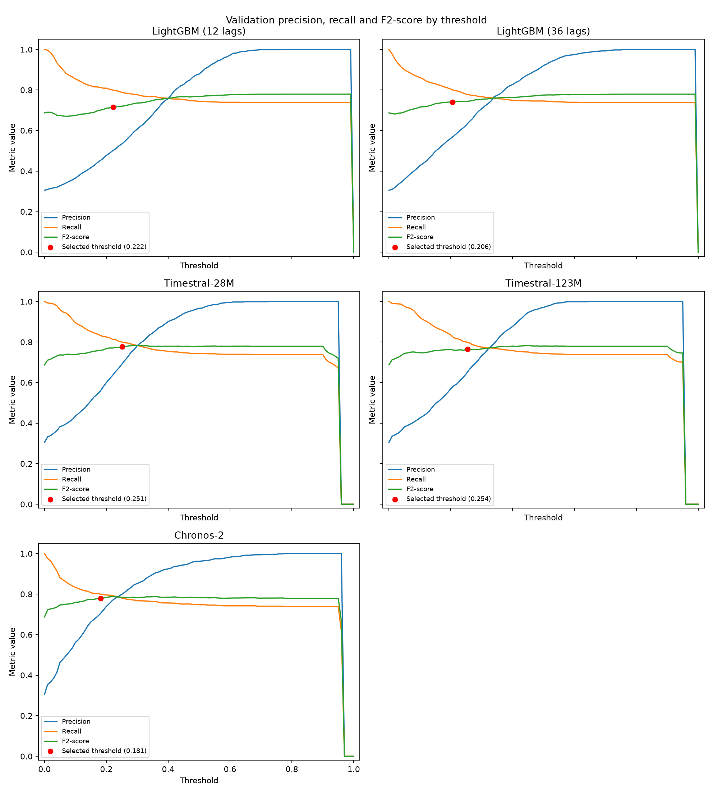
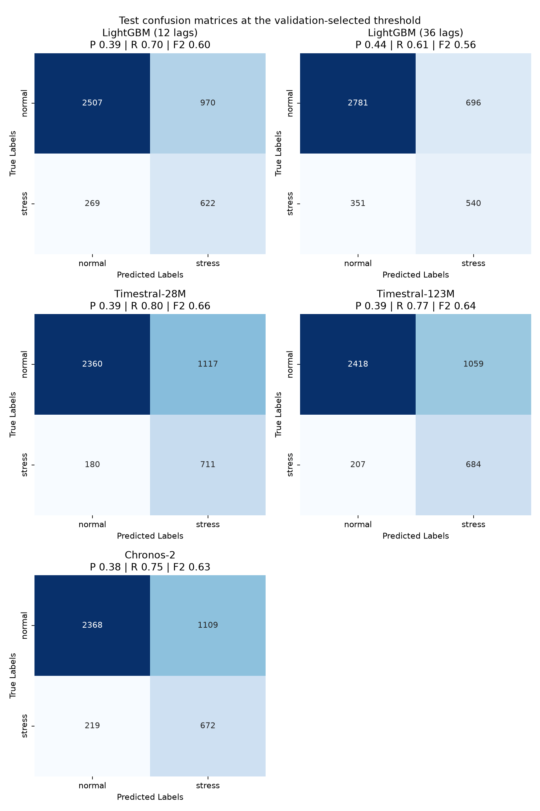
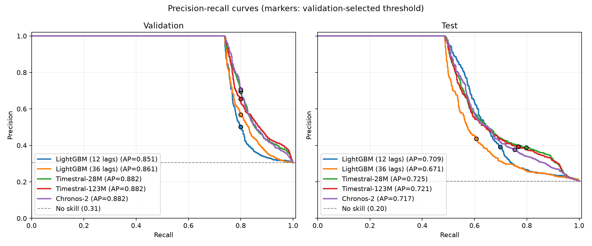

# Drought Stress Prediction

Train a LightGBM classifier to forecast vegetation stress from monthly NDVI and
ERA5 climate variables. The supported workflow is an internal, reproducible CLI
application managed with `uv`.

## Setup

Install `uv`, then create the locked Python 3.11 environment:

```powershell
uv sync --locked --group dev
uv run stress-prediction --help
```

`pyproject.toml` defines compatible dependency ranges. `uv.lock` is committed
and is the exact environment used by development and CI.

Optional dependencies are available for the geospatial pipeline, the
experimental neural models and the Timestral and Chronos-2 foundation-model
evaluations:

```powershell
uv sync --locked --extra geo
uv sync --locked --extra nn
uv sync --locked --extra foundation
uv sync --locked --extra chronos
```

## Input Data

LightGBM training expects a CSV with one monthly observation per spatial point:

- `valid_time`
- `latitude`
- `longitude`
- `vegetation_stress_class`
- `tp_mm`
- `pet_mm`
- `T_c`
- `ndvi`

Supported stress labels are `normal`, `mild`, `moderate`, and `severe`.
Duplicate `(latitude, longitude, valid_time)` observations, missing feature
values, and unknown labels are rejected before training.

Raw climate and vegetation datasets are not distributed in the Python package.
Copernicus CDS credentials are required for ERA5 downloads.

## Train

```powershell
uv run stress-prediction train-lgb `
  --input data/drought_indices.csv `
  --output-dir experiments/lightgbm `
  --n-lags 12 `
  --horizon 6 `
  --validation-start 2016-01-01 `
  --test-start 2019-01-01 `
  --trials 30 `
  --seed 42
```

Splits use the future label timestamp, rather than the feature timestamp, to
prevent labels across a temporal cutoff from leaking into an earlier partition.
They are also spatial: the grid is cut into `--spatial-block-size` degree blocks
(default 0.5), and whole blocks are held out so that about 70% / 15% / 15% of the
locations belong to training / validation / test. Each partition keeps only its
own locations within its own period, so validation and test cells are never seen
in training. The block assignment is seeded and shared by every command, and
`latitude` and `longitude` are not model features. Pass `--spatial-block-size 0`
for a time-only split.

The decision threshold is chosen on validation data only: the most precise
threshold whose recall reaches `--recall-target` (default 0.8). Missing a stress
event costs more than a false alarm, so the rule fixes the recall to deliver and
maximises precision subject to it. On these data the F2 optimum instead lands on
a very high-precision, low-recall point for LightGBM (see the model comparison).

Training writes:

- `model.pkl`: trusted internal model bundle containing the estimator,
  threshold, feature order, configuration, versions, metrics, and data hash.
- `metrics.json`: validation and test metrics for inspection and automation.
- `predictions.csv`: the validation and test label and score of every sample.
- `precision_recall.png`: validation and test precision-recall curves, including
  the validation-selected operating point.
- `confusion_matrix.png`: test predictions at the selected threshold.
- `feature_importance.png`: the 20 most important LightGBM features.

Only load `model.pkl` files produced by a trusted training run. Python pickle
artifacts are not safe to load from untrusted sources.

## Evaluate foundation models (zero-shot)

`eval-timestral` and `eval-chronos2` score pretrained forecasters on the same
samples, temporal and spatial splits, threshold selection and metrics as
`train-lgb`.
Nothing is trained. Each model has its own extra and downloads its checkpoint
on first use:

| Command | Extra | Default checkpoint |
| --- | --- | --- |
| `eval-timestral` | `foundation` | [`mistralai/Timestral-28M`](https://huggingface.co/mistralai/Timestral-28M) |
| `eval-chronos2` | `chronos` | [`amazon/chronos-2`](https://huggingface.co/amazon/chronos-2) |

```powershell
uv sync --locked --extra foundation
uv run stress-prediction eval-timestral `
  --input data/drought_indices.csv `
  --output-dir experiments/timestral `
  --checkpoint mistralai/Timestral-28M `
  --n-lags 12 `
  --horizon 6
```

Use `--max-samples N` to evaluate a fixed random subset of each split for a
quick check; omit it for results comparable with `train-lgb`.

For each sample, the last `--n-lags` months of NDVI form the forecast context,
with precipitation, PET and temperature as past covariates and the month
encoding as known-future covariates. Timestral forecasts NDVI quantiles at the
label month. The stress score is the probability that the forecast NDVI falls
below the severe-VCI limit, `P(NDVI <= ndvi_min + 0.25 * (ndvi_max - ndvi_min))`,
using the per-pixel monthly NDVI extremes from the label baseline (2003-2020).
The run checks that this rule reproduces the dataset's labels
(`label_rule_agreement` in `metrics.json`) before scoring.

`metrics.json` also reports a `persistence_baseline`, which scores each sample
by the stress of the last observed month. Compare Timestral against it as well
as against LightGBM. The baseline year range overlaps the validation and test
years because that is how the labels were defined, so absolute scores should be
compared only between methods evaluated on the same labels.

## Results

### Model comparison

Forecasting vegetation stress six months ahead (severe stress is the positive
class). LightGBM uses 12 months of history (and a 36-lag variant) and the
zero-shot models a 36-month context. All models were scored on the same 3,672
validation and 4,368 test samples, which come from held-out locations (102 and 91
of the 681 grid cells) and from label months 2016-2018 and 2019 onward
respectively. LightGBM trains on 190,320 samples from the remaining 488 cells
before 2016. The decision threshold is the most precise one on validation that
reaches a recall of 0.8, for every model.

Model scores come from `experiments/spatial/`. The `metrics.json` files there
were written when thresholds were still chosen by F2, so their thresholds and
precision / recall differ from the table below; their AP and ROC-AUC do not,
because those do not depend on the threshold. The table is
`experiments/spatial_recall/comparison_metrics.csv`, which `compare-models`
recomputes from the saved per-sample scores for any `--recall-target`, without
re-running a model.

| Model | Training | Val AP | Val ROC-AUC | Test AP | Test ROC-AUC | Test precision / recall / F2 |
| --- | --- | --- | --- | --- | --- | --- |
| LightGBM, 12 lags | tuned, 30 Optuna trials | 0.851 | 0.839 | 0.709 | 0.785 | 0.39 / 0.70 / 0.60 |
| LightGBM, 36 lags | tuned, 30 Optuna trials | 0.861 | 0.857 | 0.671 | 0.762 | 0.44 / 0.61 / 0.56 |
| Timestral-28M | zero-shot | 0.882 | 0.894 | 0.725 | 0.835 | 0.39 / 0.80 / 0.66 |
| Timestral-123M | zero-shot | 0.882 | 0.898 | 0.721 | 0.831 | 0.39 / 0.77 / 0.64 |
| Chronos-2 (120M) | zero-shot | 0.882 | 0.891 | 0.717 | 0.817 | 0.38 / 0.75 / 0.63 |
| Persistence baseline | none | 0.835 | 0.846 | 0.435 | 0.625 | 0.25 / 0.55 / 0.44 |

AP is average precision. The persistence baseline scores each sample by the
stress of the last observed month, so it shows how much a model gains beyond the
most recent observation. Its threshold is selected with the same rule from the
`persistence_score` column of the zero-shot runs' `predictions.csv`.

For comparison, selecting by F2 instead gave these test operating points:

| Model | F2-selected threshold | Test precision / recall / F2 | Recall-target threshold | Test precision / recall / F2 |
| --- | --- | --- | --- | --- |
| LightGBM, 12 lags | 0.999 | 1.00 / 0.48 / 0.54 | 0.222 | 0.39 / 0.70 / 0.60 |
| LightGBM, 36 lags | 0.999 | 1.00 / 0.48 / 0.54 | 0.206 | 0.44 / 0.61 / 0.56 |
| Timestral-28M | 0.301 | 0.44 / 0.70 / 0.62 | 0.251 | 0.39 / 0.80 / 0.66 |
| Timestral-123M | 0.453 | 0.69 / 0.55 / 0.58 | 0.254 | 0.39 / 0.77 / 0.64 |
| Chronos-2 (120M) | 0.225 | 0.41 / 0.70 / 0.62 | 0.181 | 0.38 / 0.75 / 0.63 |
| Persistence baseline | 0.810 | 0.52 / 0.49 / 0.50 | 0.331 | 0.25 / 0.55 / 0.44 |

- Every model reaches a validation recall of 0.8 by construction, with validation
  precision between 0.50 (LightGBM, 12 lags) and 0.71 (Chronos-2). On test the
  recall drops, and by different amounts: Timestral-28M keeps 0.80, Timestral-123M
  0.77 and Chronos-2 0.75, against 0.70 for LightGBM with 12 lags and 0.61 with 36
  lags. At that recall, precision is 0.38-0.44 for all models.
- The recall-target rule gives LightGBM a usable operating point (precision 0.39,
  recall 0.70) where the F2 rule picked a threshold of 0.999 with recall 0.48.
  Its test F2 rises from 0.54 to 0.60 and the zero-shot models' from 0.58-0.62 to
  0.63-0.66. The zero-shot models still lead on F2, ROC-AUC and recall retention,
  while their test AP lead over LightGBM (0.717-0.725 against 0.709) is small and
  each figure is one run on 91 test cells.
- Timestral-28M and Timestral-123M perform alike here.
- Using 36 instead of 12 lags did not help LightGBM: validation is slightly
  better, test is worse, and it has 12% fewer training samples.
- Persistence is close to the models on validation (AP 0.835) but far below them
  on test (AP 0.435), so the validation split alone is a weak yardstick.

The threshold curves, confusion matrices and precision-recall curves behind the
first table, rebuilt from each run's saved per-sample scores (`predictions.csv`):







In the precision-recall curves, the markers show each model's validation-selected
threshold and the dashed line is the positive rate (a model with no skill). All
models keep precision 1.0 up to about 0.74 recall on validation and about 0.48 on
test. Beyond that point the curves separate: on validation the zero-shot models
are above LightGBM, and on test LightGBM with 12 lags is slightly higher between
roughly 0.5 and 0.65 recall and lower beyond about 0.7, where the markers sit.

Caveats: each figure is a single run with one random block assignment and no
confidence intervals. LightGBM's features include the VCI of the sample month,
while the zero-shot context ends one month earlier, so LightGBM sees one more
month of observations. The stress labels come from NDVI extremes over 2003-2020,
which include the validation and test years, so absolute scores are only
comparable between models scored on the same labels. Earlier runs under a
time-only split are not comparable with these results.

To reproduce, regenerate `data/drought_indices.csv` with
`src/features/compute_drought_composite.py` (the example flags in its docstring,
`--start 1982-01 --end 2022-12 --out data/drought_indices.csv`). Then drop the
cells with any missing feature or label (178 cells without ERA5 values and 24
without NDVI, leaving 681 of 864), which `train-lgb` rejects, and save the
result as `data/drought_indices_clean.csv`:

```powershell
uv run stress-prediction train-lgb --input data/drought_indices_clean.csv `
  --output-dir experiments/spatial/lightgbm_lag12 --n-lags 12 --threads 4
uv run stress-prediction train-lgb --input data/drought_indices_clean.csv `
  --output-dir experiments/spatial/lightgbm_lag36 --n-lags 36 --threads 4
uv run stress-prediction eval-timestral --input data/drought_indices_clean.csv `
  --output-dir experiments/spatial/timestral_28m --n-lags 36
uv run stress-prediction eval-timestral --input data/drought_indices_clean.csv `
  --output-dir experiments/spatial/timestral_123m --n-lags 36 `
  --checkpoint mistralai/Timestral-123M
uv run stress-prediction eval-chronos2 --input data/drought_indices_clean.csv `
  --output-dir experiments/spatial/chronos2 --n-lags 36
uv run stress-prediction compare-models --recall-target 0.8 `
  --run "LightGBM (12 lags)=experiments/spatial/lightgbm_lag12" `
  --run "LightGBM (36 lags)=experiments/spatial/lightgbm_lag36" `
  --run Timestral-28M=experiments/spatial/timestral_28m `
  --run Timestral-123M=experiments/spatial/timestral_123m `
  --run Chronos-2=experiments/spatial/chronos2 `
  --output-dir experiments/spatial_recall
```

Every `train-lgb` and `eval-*` run writes `predictions.csv` (split, label and
score per sample), which `compare-models` reads. It refuses to plot runs that
were not scored on the same samples. Run with the current code, the commands
above select thresholds at `--recall-target` too, so their `metrics.json` will
match `comparison_metrics.csv`.

The three zero-shot runs record the same SHA-256 for the cleaned CSV
(`65c32932...`) in their `metrics.json`.

### Historical exploratory results

The original research run shows the expected threshold trade-off and compares
the LightGBM classifier with a logistic-regression baseline:

| Validation threshold selection | Held-out test evaluation |
| --- | --- |
|  |  |

These two panels are retained as **historical exploratory results**. They
predate the packaged workflow and do not include the model bundle, data hash,
seed, or dependency lock needed to claim them as the current benchmark.

Every new `train-lgb` run now records the validation-selected threshold, split
sizes, validation and test metrics, input-data SHA-256, package versions, and
the three evaluation figures listed above. A benchmark should be reported from
those run artifacts together with its command and `metrics.json`; this keeps
the README results traceable rather than copying unverified numbers into it.

The underlying ERA5 series provides useful context for the climate inputs and
their seasonal structure:


## Predict

Prediction input uses the same climate and location columns as training, but it
does not need `vegetation_stress_class`:

```powershell
uv run stress-prediction predict `
  --artifact experiments/lightgbm/model.pkl `
  --input data/current_observations.csv `
  --output experiments/lightgbm/predictions.csv
```

The output contains location, observation time, forecast target time, stress
probability, and binary prediction. CSV and Parquet outputs are supported;
Parquet requires the `geo` extra.

## Development

```powershell
uv run ruff format --check src/stress_prediction tests
uv run ruff check src/stress_prediction tests
uv run mypy src/stress_prediction
uv run pytest --cov=stress_prediction
uv build
```

The PyTorch sequence models and the original geospatial preparation scripts are
still experimental and are not part of the production support contract yet.